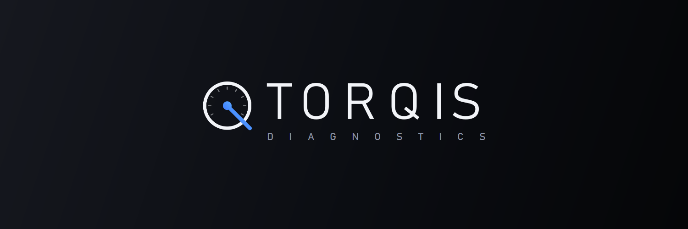
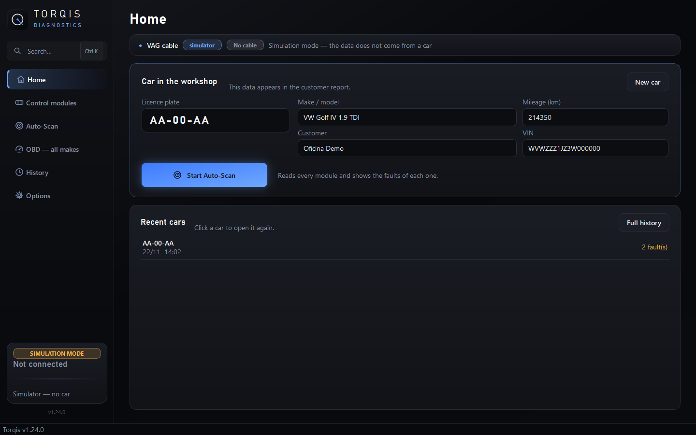
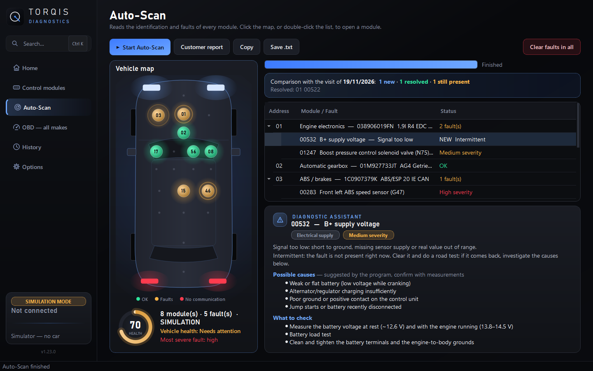
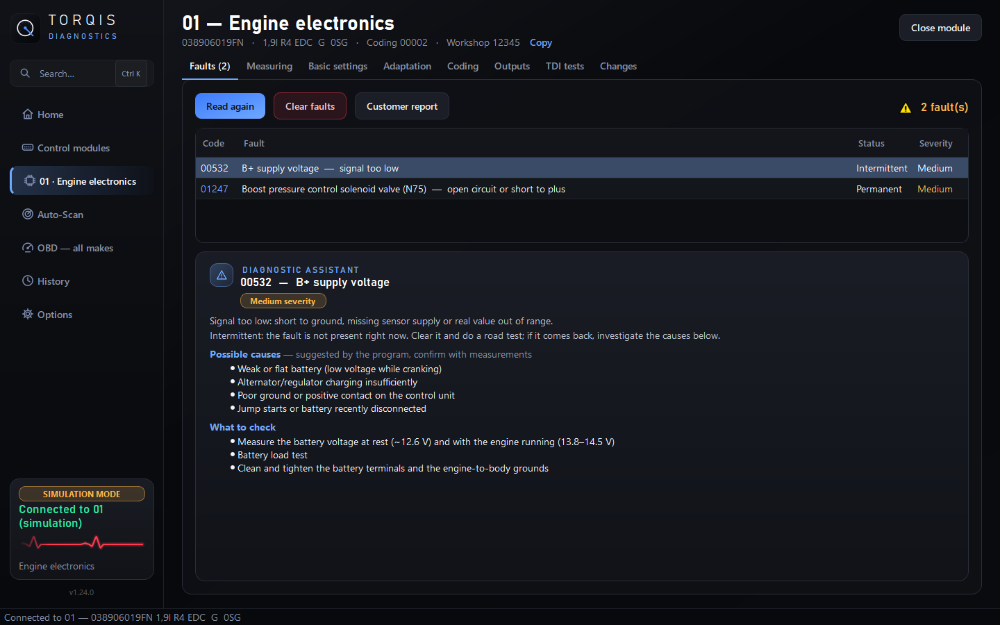
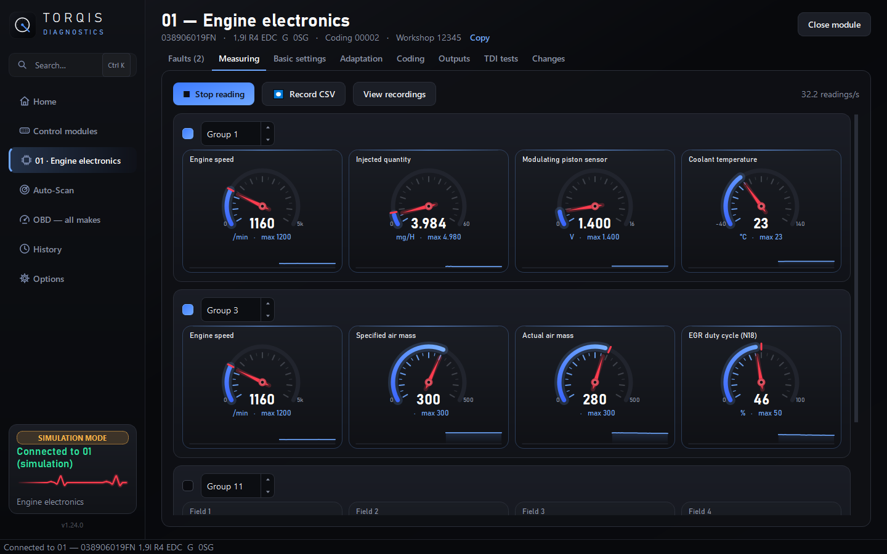

  

  <a href="README.md">Português</a> · <b>English</b>

  
  
  
  

  <b>Diagnostic software for VW Group workshops</b> — Volkswagen, Audi, Seat and Škoda.

  

---

## Download

On the [latest release](https://github.com/rNx1337k/TorqisDiagnostics/releases/latest) page, under **Assets**:

- **`Setup_Torqis_<version>.exe`** — installs the program with Start menu and desktop shortcuts (recommended)
- **`Torqis_<version>_portatil.zip`** — portable version: extract it anywhere (even a USB stick) and open
  `Torqis.exe`

The `.sig` files are signatures the program uses to check its updates; you do not need them.

> [!NOTE]
> The first time, Windows may show *"Windows protected your PC"*: click **More info → Run anyway**.

Once installed, Torqis **keeps itself up to date**: only versions signed by the publisher are installed.

## What it does

- **Auto-Scan with a vehicle map** — reads every module and shows on the car where the faults are
- **Diagnostic assistant** — severity, likely causes and what to check for each fault
- **Live data** on gauges and charts
- **Workshop functions** — basic settings, adaptation, coding, login, output tests and service reminder reset, with
  every saved value read back and the original kept so it can be restored
- **Customer reports** with the workshop logo, as PDF or printed
- **Diagnostics and customer history**, searchable by plate, VIN or customer
- **Built-in simulator** to try everything without a car

| | |
|---|---|
|  |  |
|  |  |

## What you need

- A PC with **Windows 10 or Windows 11 (64-bit)**
- A diagnostic cable:

| Cable | For |
|---|---|
| **KKL 409.1 cable with an FTDI chip** (USB) | VW, Audi, Seat and Škoda up to about 2005 (K-line) |
| **OBDLink EX** (USB) | VW Group with CAN, from about 2005 |
| **J2534 interface** (e.g. Scanmatik 2 PRO) | VW Group, K-line (KWP2000) and CAN |

Closed cables of other programs (for example VCDS HEX, Autocom, Delphi) do not work: Torqis recognises them and
explains why.

## Licence

The first **14 days** are a trial with everything unlocked. After that, without a licence, the program switches to
**demo mode**: it connects to the car, identifies the modules and says which ones have faults, but shows only part
of the faults and values and does not change anything on the car.

To get a licence: open **Options → Licence**, copy the **PC ID** and send it in a message on
[Instagram @torqis.pt](https://www.instagram.com/torqis.pt/). Paste the key you receive and click
**Activate licence**. Activation does not need the internet.

## Status

Torqis is in **beta**. Every function can be tried with the built-in simulator, and validation on real cars is in
progress. Simulated results are always labelled as such.

## Contact

Questions, licences, or a workshop that wants to try Torqis on real cars:
**[Instagram @torqis.pt](https://www.instagram.com/torqis.pt/)**.

---

Copyright © 2026. All rights reserved. Proprietary software: it may not be copied, modified or redistributed
without written permission. VW, Audi, Seat and Škoda are trademarks of their respective owners; Torqis is an
independent product and is not affiliated with Volkswagen AG.
