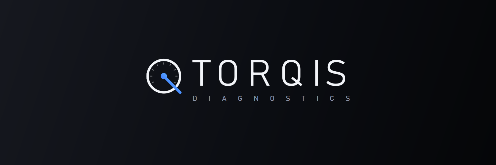
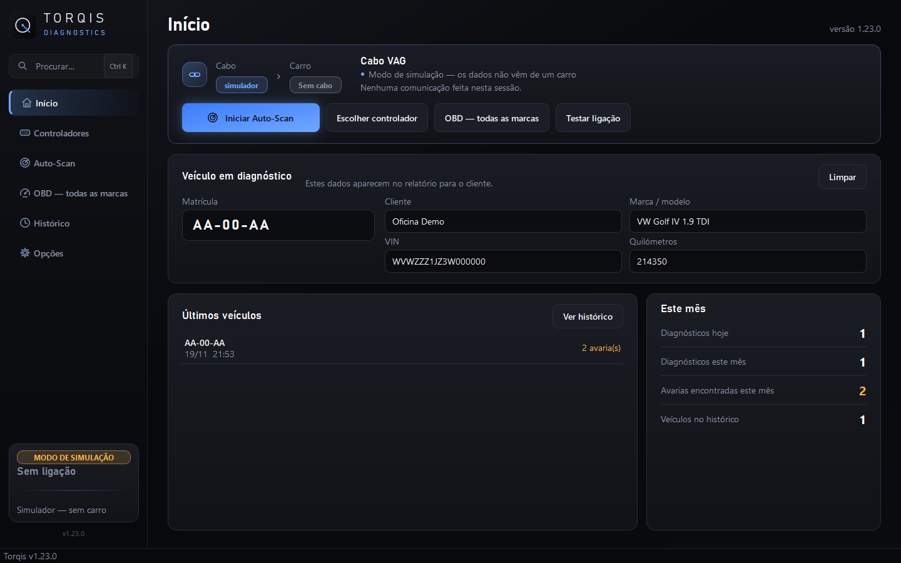
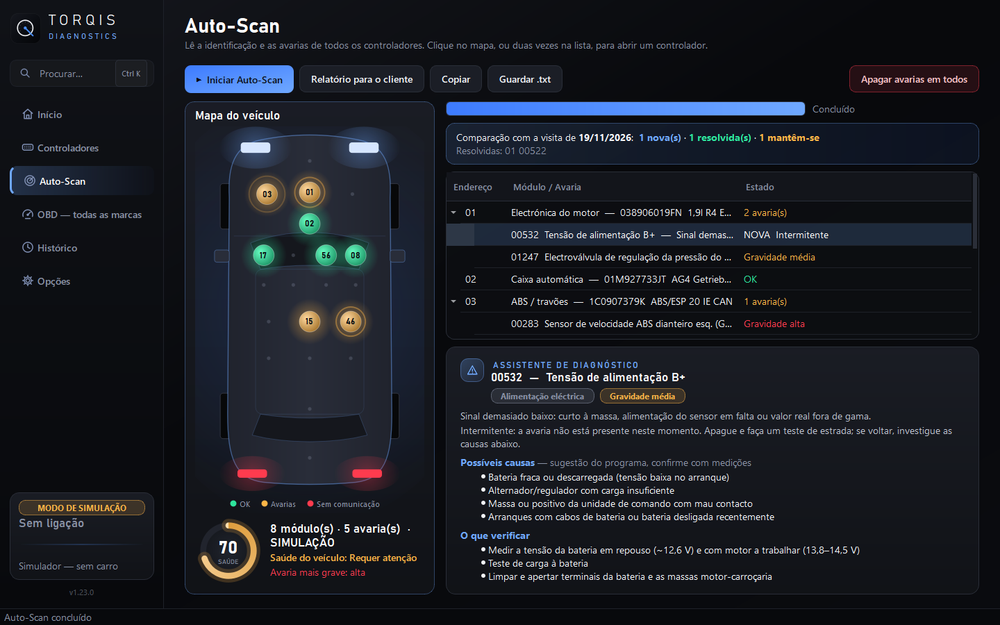
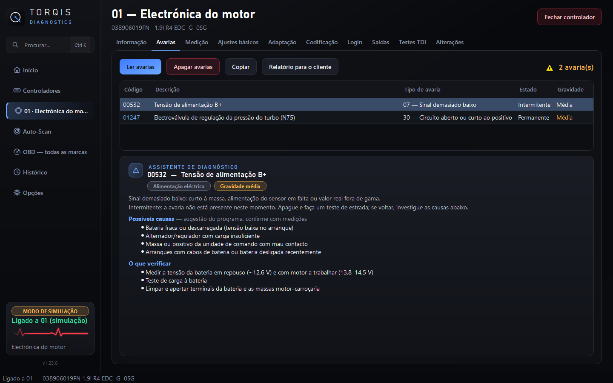
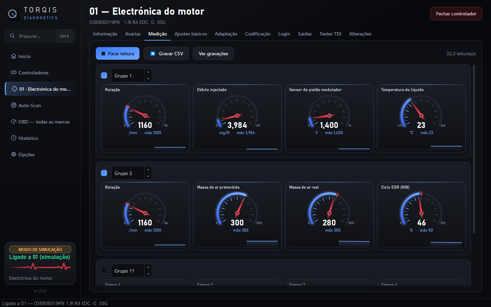

  

  <b>Português</b> · <a href="README.en.md">English</a>

  
  
  
  

  <b>Programa de diagnóstico para oficinas do grupo VAG</b> — Volkswagen, Audi, Seat e Škoda.

  

---

## Descarregar

Na página da [última versão](https://github.com/rNx1337k/Torqis-download/releases/latest), em **Assets**:

- **`Setup_Torqis_<versão>.exe`** — instala o programa, com atalhos no menu Iniciar e no ambiente de trabalho
  (recomendado)
- **`Torqis_<versão>_portatil.zip`** — versão portátil: extraia para qualquer pasta (até uma pen) e abra o
  `Torqis.exe`

Os ficheiros `.sig` são as assinaturas que o programa usa para confirmar as actualizações; não precisa deles.

> [!NOTE]
> Na primeira vez o Windows pode mostrar *"O Windows protegeu o PC"*: carregue em **Mais informações → Executar
> mesmo assim**.

Depois de instalado, o Torqis **actualiza-se sozinho**: só são instaladas versões assinadas pelo editor.

## O que faz

- **Auto-Scan com mapa do veículo** — lê todos os controladores e mostra no carro onde estão as avarias
- **Assistente de diagnóstico** — gravidade, causas prováveis e o que verificar em cada avaria
- **Valores em tempo real** em mostradores e gráficos
- **Funções de oficina** — ajustes básicos, adaptação, codificação, login, teste de saídas e reposição do indicador
  de revisão, com cada valor gravado lido de volta e o original guardado para repor
- **Relatórios para o cliente** com o logótipo da oficina, em PDF ou impressos
- **Histórico de diagnósticos e de clientes**, pesquisável por matrícula, VIN ou cliente
- **Simulador incluído** para experimentar tudo sem carro

| | |
|---|---|
|  |  |
|  |  |

## O que precisa

- Um PC com **Windows 10 ou Windows 11 (64 bits)**
- Um cabo de diagnóstico:

| Cabo | Para |
|---|---|
| **Cabo KKL 409.1 com chip FTDI** (USB) | VW, Audi, Seat e Škoda até cerca de 2005 (linha K) |
| **OBDLink EX** (USB) | Grupo VAG com CAN, de cerca de 2005 em diante |
| **Interface J2534** (ex.: Scanmatik 2 PRO) | Grupo VAG, linha K (KWP2000) e CAN |

Os cabos fechados de outros programas (por exemplo os HEX do VCDS, Autocom, Delphi) não funcionam: o Torqis
reconhece-os e explica porquê.

## Licença

Os primeiros **14 dias** são um teste com tudo desbloqueado. Depois, sem licença, o programa passa a **modo
demonstração**: liga ao carro, identifica os controladores e diz que módulos têm avarias, mas mostra só parte das
avarias e dos valores e não altera nada no carro.

Para obter a licença: abra **Opções → Licença**, copie o **ID deste PC** e envie-o por mensagem no
[Instagram @torqis.pt](https://www.instagram.com/torqis.pt/). Cole a chave que receber e carregue em
**Activar licença**. A activação não precisa de internet.

## Estado

O Torqis está em **beta**. Todas as funções podem ser experimentadas com o simulador incluído e a validação em
carros reais está em curso. Os resultados simulados aparecem sempre identificados como tal.

## Contacto

Dúvidas, licenças, ou uma oficina que queira experimentar o Torqis em carros reais:
**[Instagram @torqis.pt](https://www.instagram.com/torqis.pt/)**.

---

Copyright © 2026. Todos os direitos reservados. Software proprietário: não pode ser copiado, modificado nem
redistribuído sem autorização escrita. VW, Audi, Seat e Škoda são marcas dos respectivos donos; o Torqis é um
produto independente, sem ligação à Volkswagen AG.
